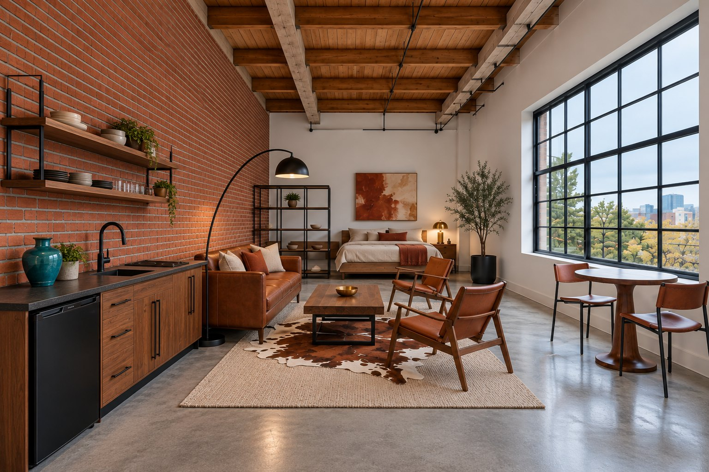

# Brick & Saddle Loft

A 320 sq ft loft lookbook built from a structured design brief. Every render is checked against that brief, and every piece in the final view links to a suggested product.

**Interactive version:** [klosetk.github.io/brick-and-saddle-loft](https://klosetk.github.io/brick-and-saddle-loft/). Hover, tap, or tab to the dots on the image to see each piece's spec and what to shop for.

## What's in this folder

| File | What it is |
| --- | --- |
| [`index.html`](index.html) | The lookbook page with the hover-to-shop overlay |
| [`items.json`](items.json) | Data for the overlay and shopping list: spec, suggested product, listed price, notes |
| [`template.md`](template.md) | The reusable six-pillar design brief |
| [`prompts.md`](prompts.md) | The locked "before" prompt and the final "after" prompt, with shot lines |
| [`accuracy.md`](accuracy.md) | The 44-check rubric, scores, and the three-version audit log |
| [`shopping.md`](shopping.md) | Shopping table with listed prices |
| [`images/`](images) | Final render and the two earlier iterations |

## The method in one pass

1. **Fix the facts.** Dimensions, ceiling, window, walls, floor, and plumbing are written down first and never change.
2. **Set the style ratio.** 60% Mid-Century Modern, 25% Industrial, 15% Western Americana. The industrial share comes from the building, and the Western share comes from materials only.
3. **Tie the palette to the light.** The window faces north, so daylight is cool. The palette runs warm and the only warm light comes from two 2700K lamps.
4. **Specify pieces as material plus placement.** For example, "84-inch cognac top-grain leather sofa centered on the brick wall facing the window."
5. **State constraints and exclusions.** Renter-friendly and freestanding. No chrome, stainless, barn wood, skulls, or striped patterns.
6. **Specify the output.** 5-ft eye level, 24 mm, f/8, straight verticals, 3:2, one image per generation.

## Accuracy

The final render scores **40 of 44 checks (91%)** against the brief in a manual visual review of view A1. The scores are judgments by eye, not pixel measurements. See [`accuracy.md`](accuracy.md) for every check.

Known gaps in the final render:
- The two sling chairs sit together on one side of the coffee table instead of flanking it.
- Wall-mounted open shelving and dishes appear over the kitchenette counter, which the brief excludes.
- The rug still reads textured, and the window grid looks denser than the specified 12 panes.

Views A2 and A3 have not been regenerated from the final prompt yet.

## Notes on the product suggestions

Prices are the listed prices saved in the shopping notes and may have changed. Product names were saved partly truncated, so confirm the exact listing before buying. The kitchenette, bedside table, shelf divider, art, and bedding are specified but not sourced.
